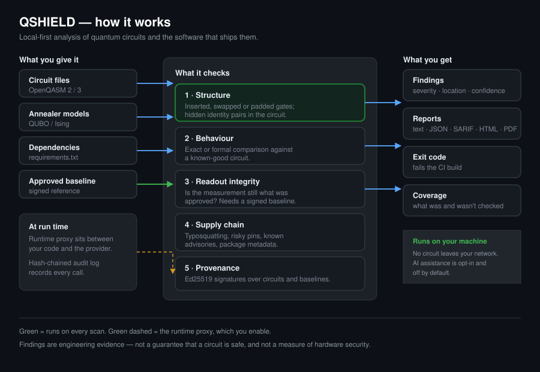

<div align="center">

# QSHIELD

### Security checks for quantum circuits and the software that ships them.

[](https://pypi.org/project/qshield/)
[](https://pypi.org/project/qshield/)
[](LICENSE)

[Workbench](https://katepallewarprathmesh-sketch.github.io/QShield/workbench.html) · [Changelog](CHANGELOG.md)

</div>

## What it does

You write a quantum program. Something changes before it runs — a gate is swapped, a measurement is flipped, a dependency is tampered with. QSHIELD looks for that, and tells you where.

It reads a circuit, checks it, and gives you a report you can act on. It runs on your own machine.

## Install

```bash
pip install qshield
```

Optional extras, only if you need them:

| Extra | Adds |
|---|---|
| `qshield[qiskit,cirq]` | Parsers for Qiskit and Cirq |
| `qshield[braket]` | Amazon Braket circuits |
| `qshield[pytket]` | pytket circuits |
| `qshield[formal]` | PyZX and Z3 verification |
| `qshield[plugins]` | Sandboxed detector plugins |

Python 3.10 or later.

## Try it

```bash
qshield scan circuit.qasm                  # check one file
qshield scan . --recursive --format sarif  # check a whole project
qshield compare original.qasm candidate.qasm   # are these two the same circuit?
qshield ui                                 # open the browser Workbench
```

In Python:

```python
import qshield

results = qshield.scan("circuit.qasm")
print(results.is_clean)
```

## How it works



You give it a circuit, a model, or a list of dependencies. It runs five checks. You get findings you can put in a ticket, wire into CI, or read yourself.

## The one check that needs extra setup

Most checks work out of the box. One does not.

**Readout checks need something to compare against.** A gate right before a measurement is normal — Deutsch's algorithm does it, and so does Bernstein–Vazirani. So "there is a gate before the measurement" tells you nothing on its own. You need to know what was approved.

QSHIELD compares your circuit against a reference you signed off earlier. If you haven't set one up, it says *not checked* rather than *fine* — because those are different answers.

```bash
# 1. Record what you approved, then sign it
qshield provenance keygen --private-key priv.pem --public-key pub.pem
qshield baseline create approved.qasm --workload my-circuit --approved-by you@example.com -o bl.json
qshield baseline sign bl.json --private-key priv.pem

# 2. Check a candidate against it (exit code 1 if the readout changed)
qshield baseline scan new.qasm -b bl.json -c approved.qasm \
    --public-key pub.pem --workload my-circuit
```

Without the `--no-passphrase` flag, step 1 asks you to choose a passphrase. Add `--no-passphrase` for scripts and CI.

## Reports

One scan can produce five formats, depending on who needs to read it:

| Format | Use it for |
|---|---|
| text | reading in a terminal |
| JSON | your own tooling |
| SARIF | GitHub code scanning |
| HTML | sharing with a team |
| PDF | attaching to a review |

`--fail-on high` makes the command exit non-zero, so CI blocks the build.

## Benchmark

The test corpus is public, so you don't have to take our word for the numbers:

```bash
qshield benchmark
```

It scores 417 bundled circuits — 202 clean, 215 with a deliberately planted flaw — and prints detection rates. Run it yourself and compare.

Benchmark figures describe this corpus. They are not a promise about your circuits.

## What it does not do

- It does not secure quantum hardware.
- It does not guarantee it finds every tampered circuit.
- It does not prove your algorithm is correct.
- A clean result means these checks found nothing. It does not mean nothing is there.

## Workbench

`qshield ui` opens a local web page. Pick a circuit file, click **Scan**, read the results. Nothing is uploaded.

## Run-time protection

The runtime proxy sits between your code and a cloud quantum provider. It logs every call to a tamper-evident chain, so you can prove afterwards what was sent and when.

```bash
qshield runtime proxy --upstream https://provider.example/api \
  --audit-chain /var/log/qshield/audit.jsonl
qshield runtime audit-verify /var/log/qshield/audit.jsonl
```

## Annealer models

If you submit a QUBO or Ising model to a solver rather than a circuit, `qshield audit-qubo` checks it first:

```bash
qshield audit-qubo model.qubo --expected-digest <hex>
```

The digest covers every coefficient at full precision. If someone edits the model after you approved it, the digest changes — even for an edit too small for a solver to notice.

## Contextuality

`qshield contextuality` checks whether a circuit really produces a non-classical result. Useful when you need to show it is not secretly doing something classical.

## Development

```bash
git clone https://github.com/katepallewarprathmesh-sketch/QShield
cd QShield
pip install -e '.[dev]'
./scripts/verify.sh          # runs everything CI runs
```

`./scripts/verify.sh --fast` skips the benchmark for a quicker loop.

## Security architecture


The diagram above is the whole picture: local analysis, five checks, reports, and an optional runtime proxy.

For the threat model, what each check covers, and deployment guidance, see the [public security architecture](https://katepallewarprathmesh-sketch.github.io/QShield/security-architecture.html).

## More

- [CHANGELOG.md](CHANGELOG.md) — what changed, and when
- [SECURITY.md](SECURITY.md) — how to report a vulnerability
- [LICENSE](LICENSE) — Apache 2.0
